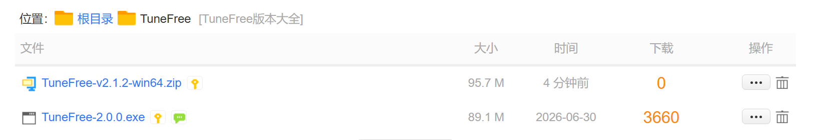

# `TuneFree`

**把 QQ音乐下载的加密歌曲（`.mflac` / `.mgg`）一键还原成任何播放器都能放的 `FLAC` / `OGG`，并自动补上封面。**

[](https://github.com/zksbx/TuneFree/releases/latest)
[](https://wwbtj.lanzouc.com/b01d7csi8j)
[](https://github.com/zksbx/TuneFree/stargazers)
[](LICENSE)
[](#系统要求)
[](https://github.com/Dora-z/TuneFree_Mac)
[](#支持)

不需要会员，不需要上传，全程在你自己的电脑上完成。

[⬇️ 下载最新版](https://github.com/zksbx/TuneFree/releases/latest) · [🌐 官网与使用帮助](https://zksbx.github.io/TuneFree/) · [☁️ 蓝奏云备用下载](https://wwbtj.lanzouc.com/b01d7csi8j)（提取码 `0211`）· 💬 `QQ` 群：1067975918 · [English](README.en.md)

> 🍎 **macOS 版**：由 [Dora-z](https://github.com/Dora-z/TuneFree_Mac) **独立开发维护**
> [Dora-z/TuneFree_Mac](https://github.com/Dora-z/TuneFree_Mac) 
---

## 它解决什么问题

在 QQ音乐里下载的部分歌曲是加密格式：

| 后缀 | 实际内容 | 常见场景 |
|---|---|---|
| `.mflac` | 加密的 `FLAC`（无损） | 无损音质下载 |
| `.mgg` | 加密的 `OGG` | 部分版权歌曲 |

这些文件只有 `QQ`音乐能放，拷到车机、`MP3`、其他播放器里全是「格式不支持」。

`TuneFree` 做的事很简单：**在 `QQ`音乐进程内调用它自己的解密函数**，把文件还原成正常的 `FLAC/OGG`，不再转码。解密完成后如果文件里没有封面，会自动从 QQ 音乐的专辑图缓存补一张。

```
.mflac  ──解密──▶  .flac
.mgg    ──解密──▶  .ogg
```

## 三步就能用

1. **打开 QQ音乐并登录**，保持运行（不用播放歌曲）
2. 双击 `TuneFree.exe`，点顶栏左侧的文件夹按钮，选存放 `.mflac` 或 `.mgg` 的目录（也可以直接把文件夹拖进窗口）
3. 点「开始解密」，等进度跑完，去 `output\flac` / `output\ogg` 拿结果（完成后会弹提示，开了系统通知也会收到通知）

解密出来的文件名和原曲一致，可以直接拷进手机或车机。

## 赞赏

`TuneFree` 完全免费，没有广告，也不会做任何限制功能来收费。如果 `TuneFree` 确实帮到了您，您可以选择请作者喝杯奶茶：

<p align="center">
  
</p>

不想花钱也完全没关系——[点个 Star](https://github.com/zksbx/TuneFree) 或者把它告诉需要的人，同样是很大的帮助。

## 是不是病毒？先看这个

上一版 **v2.0.0** 于 **2026-06-30** 发布，到 **2026-10-31** 在蓝奏云上被下载了 **3660 次**（数字由蓝奏云后台统计，作者改不了）。几千个人装过、用过的工具，真有问题是藏不住的。

<p align="center">
  <a href="docs/downloads.png"></a>
</p>

程序确实会被杀软报警——因为它用 `Frida` 往 `QQ`音乐进程里注入代码，这个动作和恶意软件一模一样。区别在于源码全部公开，你可以自己看它在做什么。

## 功能

- 🎵 支持 `.mflac` / `.mgg` 批量解密，自动递归子文件夹
- 🖼 解密后自动补封面：文件里没有图时，从 QQ 音乐的专辑图缓存挑最大的一张写进 `PICTURE` / `METADATA_BLOCK_PICTURE`
- 🏷 格式胶囊标清每首歌的当前形态：`MFLAC` / `MGG` 是还没解密，`FLAC` / `OGG` 是解密好了
- 🗂 格式胶囊一键筛选：全部 / 未解密 / `MFLAC` / `MGG` / `FLAC` / `OGG`，计数实时更新；点「筛选」还能按歌手过滤
- 🎧 双击列表就地试听，播放条带封面和两行歌词；点封面或「沉浸」进整页播放页，左边封面与进度、右边中英双语歌词
- 🔀 同名歌曲有多份文件时，播放条上可以直接选听哪一版
- 🪟 迷你播放器：缩成小窗浮在桌面一角，带歌词与进度，位置会记住
- 📥 拖拽导入：把文件夹拖进窗口就开始扫描，不用点按钮
- ⌨️ 全局媒体键：键盘上的播放 / 暂停、上一首、下一首直接控制；应用内还有一组快捷键
- 🔔 托盘常驻：关窗口不退出，解密在后台继续跑；解完发系统通知
- 🎨 浅色 / 深色两套内置配色，另可自存三套自定义配色；界面字号、歌词字号都能调
- ⚡ 断点续跑：中途关掉，重跑会跳过已经解出来的文件
- 🔄 自动检查更新，同意后原地覆盖升级，配色、字号、解密选项全部保留
- 📖 断网也能查帮助：使用帮助与赞赏页会回落到程序自带的说明书，不需要等网络
- 🔒 不联网、不上传，除了检查更新不会连接任何服务器

## 系统要求

- Windows 10 / 11 64 位
- `QQ`音乐客户端（需要登录）
- **歌曲音质只支持「标准 / HQ / SQ」三档**。Hi-Res（臻品音质）、臻品母带、杜比全景声这类格式不在支持范围内，解密会失败。

## 常见问题

### 双击提示「Windows 已保护你的电脑」，蓝色窗口不让运行

那是 SmartScreen 的「未知发布者」提示，不是报毒——没买代码签名证书的 exe 第一次运行都会被拦。

两个办法任选：

1. **还没解压（推荐）**：右键那个 zip → 属性 → 在「常规」页最底下勾选「解除锁定」→ 确定，然后再解压。解出来的文件不再被标记为「来自网络」，以后都不会弹。
2. **已经解压了**：蓝窗口里点「更多信息」，再点右下角「仍要运行」。同一份文件点一次就够。

压缩包根目录里还放了一份 `!首次运行请看.txt`。不过那份文件是解压之后才看得到的，所以里面只写了第 2 种办法（外加被杀软拦住时怎么加信任区），第 1 种办法得在解压前动手。

### 杀毒软件报毒怎么办？

程序用 Frida 往 QQ音乐进程里注入代码——这个行为本身就跟病毒一模一样，所以杀软基本都会报。

解决办法：把 TuneFree 目录加入杀软信任区。源码完全公开，你可以自己看每一行在做什么。

### 提示「请确保 QQ音乐客户端正在运行后重试」

先把 QQ音乐打开并登录，再点开始。解密依赖 QQ音乐进程里的密钥，它没运行就没有密钥可用。

### 解密报 `invalid size` 或「QQ音乐版本不匹配」

QQ音乐更新后改了内部函数名，当前版本注入不进去。

- 把 QQ音乐降级到已知可用的版本，或者
- 等 TuneFree 适配新版本（关注 Release）

### 解密出来没有封面

封面不会跟着 `.mflac` / `.mgg` 一起下载——「同时下载专辑图片」只是让 QQ音乐把图放进它自己的缓存。TuneFree 解密完成后会去 `%APPDATA%\Tencent\QQMusic\QQMusicCache\QQMusicPicture` 按「歌手 + 专辑」找图并写进文件；缓存里没有就保持原样（解密选项里可以关掉自动补封面）。

### 有少数歌死活解不出来

先看音质。程序只支持 **标准 / HQ / SQ** 三档，如果这首歌在 QQ音乐里下的是 **Hi-Res（臻品音质）、臻品母带、杜比全景声**，拿到的就不是普通音频流，解密必然失败——把那首歌的音质改成 SQ 或更低，重新下载一次即可。

确认是标准 / HQ / SQ 还解不出来，多半需要先在 QQ音乐里播放一遍，让它完成解密加载，再运行 TuneFree。

### 支持 Mac / Linux 吗？

**Windows 版**是这里发布的唯一官方版本——注入目标 QQ音乐只有 Windows 版。

**macOS 版**由 [Dora-z](https://github.com/Dora-z/TuneFree_Mac) 独立开发维护，用的是另一套思路：不注入进程，在本机复现解密算法，新版 `musicex` 格式则读取本机 QQ音乐的登录态向官方接口取密钥。源码、发布包、问题反馈都在他的仓库：

👉 **[github.com/Dora-z/TuneFree_Mac](https://github.com/Dora-z/TuneFree_Mac)**

Linux 目前没有人维护。

## 从源码运行

```bash
# 1. 装依赖
pip install -r requirements.txt

# 2. 启动图形界面
python app.py

# 或者用命令行（app.py 和 main.py 都行）
python app.py --cli -i "D:\下载" -o "D:\音乐"
python main.py -i "D:\下载" -o "D:\音乐"
```

命令行参数：

| 参数 | 说明 |
|---|---|
| `-i, --input` | 输入目录，默认当前目录 |
| `-o, --output` | 输出根目录，默认 `./output`（其下分 `flac` / `ogg`） |
| `--flac-dir` / `--ogg-dir` | 分别指定 `FLAC` / `OGG` 输出位置 |
| `--no-cover` | 不自动补封面 |
| `--force` | 已经解出来的文件也重新解密 |
| `-v, --version` | 显示版本号 |

## 项目结构

```
app.py               唯一入口：不带参数开界面，带 --cli 走命令行
TuneFree.py          图形界面主窗口与所有自绘控件（PySide6）
miniplayer.py        迷你播放器小窗
hotkeys.py           全局媒体键（低级键盘钩子）
player.py            播放器封装（QMediaPlayer）
lyrics.py            歌词匹配、解析与缓存
main.py              命令行 / 后端：注入、解密、补封面
scanner.py           扫描歌曲目录，读元信息、找封面
metainfo.py          FLAC / OGG / MP3 头解析
coverart.py          从 QQ音乐图片缓存找封面并写进 FLAC / OGG
session.py           与会话/进程注入相关的封装
hook_qq_music.js     Frida 注入脚本（解密核心）
version.py           版本号与仓库地址的唯一来源
version.json         给国内用户用的更新源（经 jsDelivr）
TuneFree.spec        PyInstaller 打包配置（只产出一个 TuneFree.exe）
docs/                官网（静态单页，中英双语）
发版清单.md           发版流程备忘
```

## 免责声明

本工具仅供**个人学习交流**使用，用于解密本机已合法下载的音乐文件，方便在自己拥有的设备上播放。

请勿用于传播、二次分发或商业用途。使用产生的一切法律责任由使用者自行承担。

## 许可

代码以 [MIT License](LICENSE) 开源，欢迎 fork、修改、二次开发。

需要提醒的是：MIT 授权的是**代码**，不改变上面免责声明里对**使用场景**的限制。

## 鸣谢

- [Frida](https://frida.re/) — 进程注入
- [mutagen](https://mutagen.readthedocs.io/) — 封面与标签读写
- [FFmpeg](https://ffmpeg.org/) — 音频格式参考（本版不再用于转码）
- [music-decryptor](https://github.com/ericjuice/music-decryptor) — 解密脚本的起点
- [Unlock Music](https://github.com/unlock-music/unlock-music) — 加密格式的解析经验
- [PyInstaller](https://pyinstaller.org/) — 打包
- [Dora-z/TuneFree_Mac](https://github.com/Dora-z/TuneFree_Mac) — macOS 版，独立实现

## 支持

- 🐛 [提 Issue](https://github.com/zksbx/TuneFree/issues)
- 💬 `QQ` 群：1067975918
- ☕ [爱发电](https://ifdian.net/a/TuneFree)
